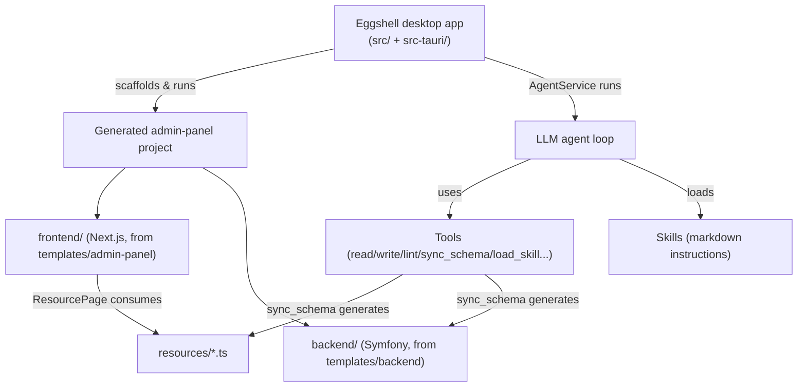

# Eggshell Codebase Guide

Eggshell is a **Tauri 2 desktop app** (Rust backend + Vite/React frontend) that acts
as a platform-guided AI app builder. It scaffolds and iteratively builds
"admin-panel" web apps made of a **Symfony/PHP backend** and a **Next.js/React
frontend**, driven by LLM agents with a tool + skill system.

This skill helps you **navigate the codebase and understand how it works**. It is
not about any single past change — it is a durable map you can consult to find
the right file before editing.

## When to Use

- You need to locate where a feature lives (backend, frontend, templates, tools).
- You are about to change the Rust backend, the agent tool/skill system, or the
  desktop shell and want the lay of the land first.
- You need to understand the resource/CRUD system or the generated-project
  templates before working inside them.
- You want the build/run/test commands.

## How to Use This Skill

Start here, then open the reference file that matches your question. Each
reference is deliberately small and focused so you load only what you need.

| Question | Reference |
|---|---|
| What are the top-level folders and tech stack? Where do I start? | [`references/overview.md`](./references/overview.md) |
| How is the Rust backend organized? What Tauri commands exist? | [`references/rust-backend.md`](./references/rust-backend.md) |
| How does Eggshell's agent **skill** system work end to end? | [`references/skill-system.md`](./references/skill-system.md) |
| What **tools** does the agent have, and what does each do? | [`references/tools.md`](./references/tools.md) |
| How does the desktop **Vite/React** shell talk to Rust? | [`references/desktop-frontend.md`](./references/desktop-frontend.md) |
| What is in the **project templates** (Symfony + Next.js)? | [`references/templates.md`](./references/templates.md) |
| How does the **resource/CRUD** system and `sync_schema` work? | [`references/resource-system.md`](./references/resource-system.md) |
| How do I build, run, and lint things? | [`references/build-and-run.md`](./references/build-and-run.md) |

## The 30-Second Mental Model

- **`src-tauri/`** — Rust core: Tauri commands, the agent loop, tools, skills,
  and the shell implementations that copy templates and start dev servers.
- **`src/`** — the React (Vite) UI of the Eggshell window itself.
- **`templates/`** — the code that gets copied into each new generated project.
- **`src-tauri/src/skills/<skill>/SKILL.md`** — the instruction documents the
  agent loads on demand (this is *different from* the skill you are reading now).

> **Two different "skills" — do not confuse them.**
> 1. **Eggshell's runtime skills** (Rust `trait Skill` + markdown in
>    `src-tauri/src/skills/`) are instructions for the *LLM agent that builds
>    user apps*. Documented in [`references/skill-system.md`](./references/skill-system.md).
> 2. **VS Code agent skills** (`SKILL.md` folders under `.agents/skills/`) are
>    instructions for *you*, the coding assistant. This file is one of those.

## Key Entry Points (jump-off points)

| I want to... | Start at |
|---|---|
| Add/change a Tauri command | `src-tauri/src/lib.rs` |
| Change the agent loop | `src-tauri/src/agent.rs` (`AgentService::run_agent`) |
| Add or change a tool | `src-tauri/src/tools/` (+ register in `tools/mod.rs`) |
| Add or change a runtime skill | create `src-tauri/src/skills/<name>/SKILL.md` with frontmatter — no Rust wiring needed |
| Change an agent mode's system prompt or tools | `src-tauri/src/apps/` (`admin_panel.rs`, `planning.rs`, `qa.rs`, `max_planner.rs`) |
| Opt a mode out of the skills catalogue | pass `skills: Some(Vec::new())` in `AgentOptions` (see `max.rs::run_max_breakdown`) |
| Change the desktop UI | `src/App.tsx`, `src/Chat.tsx` |
| Change generated frontend | `templates/admin-panel/` |
| Change generated backend | `templates/backend/` |
| Understand resource generation | `src-tauri/src/tools/sync_schema.rs` |

## Conventions to Keep in Mind

- The Rust lib is named `eggshell_lib` (not `eggshell`) — see `Cargo.toml`.
- Templates are bundled as Tauri resources (`../templates/**/*` in `tauri.conf.json`),
  so new template files ship automatically.
- Runtime skills live in `src-tauri/src/skills/<skill>/SKILL.md` and are embedded
  recursively with `include_dir!` (`skill_loader.rs`). Metadata comes from YAML
  frontmatter; supporting files (e.g. `docs/*.md`) are bundled but not advertised,
  and are read through `load_skill({ skillName, path })`.
- Tool file paths are always relative to a shell's `src/` directory (`frontend`
  or `backend`), never absolute.
